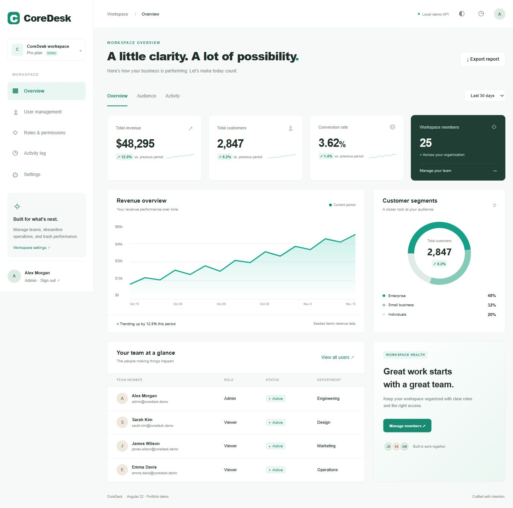

# CoreDesk – Enterprise Management Platform

Manage teams, streamline operations, and track performance.

An Angular 22 portfolio application with a working Node REST API. Built around team administration, business analytics and role-based access. Seeded analytics and fixed demo accounts make it safe to explore locally.

**Live demo:** https://coredesk-admin.vercel.app

## Start

Node 24.15+ and npm are required.

```powershell
npm ci
npm start -- --open
```

Open http://127.0.0.1:4200. The command starts both the API and Angular; keep the terminal running. Ctrl+C stops the application. For separate terminals, use npm run api and npm run start:ui. Stop older Angular/API terminals before restarting so two processes do not bind different localhost addresses.

| Role | Email | Password |
| --- | --- | --- |
| Admin | admin@coredesk.demo | Demo@123 |
| Manager | manager@coredesk.demo | Demo@123 |
| Viewer | viewer@coredesk.demo | Demo@123 |

Credentials are also in src/assets/demo-login-credentials.txt. They are public demo accounts, not production secrets.

## Features

- Analytics, reporting-period selection, reusable SVG revenue chart and CSV export.
- User creation, editing and deletion with confirmation; search, filters, sorting and pagination.
- Reactive forms, whitespace/length/email validation, duplicate-email responses and retryable error states.
- Admin/Manager/Viewer authorization enforced by the REST API as well as navigation and action visibility.
- Signed access JWTs, rotating HttpOnly refresh cookies, automatic refresh/retry and logout revocation.
- Responsive sidebar with pinned sign out, mobile navigation, dark mode, preferences and audit events.

## Screenshots



[User management](docs/screenshots/users.png) · [Mobile sidebar](docs/screenshots/mobile-sidebar.png)

## Code organization

Every component has separate .component.ts, .component.html, .component.css and .component.spec.ts files. Feature folders contain pages, typed models and HTTP services. Shared UI includes status badges, async states and confirmation dialogs. Core contains authentication, route guards, the interceptor, API configuration and theme management.

See [architecture](docs/architecture.md) for the folder tree, boundaries and tradeoffs, and [client demo](docs/client-demo.md) for a walkthrough and release status.

## Checks

```powershell
npm run format:check
npm run test:ci
npm run test:api
npm run build
```

Use npm run format to apply formatting. GitHub Actions is configured in .github/workflows/ci.yml; a workflow run is only verified after it has actually run on GitHub.

## REST endpoints

POST /api/auth/login, POST /api/auth/refresh, POST /api/auth/logout; GET /api/analytics?period=30|90|365; GET/POST /api/users; PUT/DELETE /api/users/:id; GET /api/audit.

Angular proxies /api to 127.0.0.1:3001. The API stores local development records in ignored server/data/db.json; hosted users, audit events and refresh sessions use Neon PostgreSQL. API tests use an isolated temporary directory. Signing keys default to a random process-local key; set COREDESK_JWT_SECRET in the hosting environment for a stable key. Refresh cookies are Secure when NODE_ENV=production; use HTTPS in that environment.

## Demo boundaries

Business analytics are seeded values. Preferences are browser-local. The directory does not provision login identities. Local API sessions reset on server restart. Hosted sessions persist in PostgreSQL. Fixed demo credentials, in-memory sessions and local JSON storage are for demonstration; production needs an identity provider, rate limiting, a transactional database, durable audit history and monitoring. Do not enter real personal or client data.

Suggested repository: coredesk-admin. The full-stack application is live on Vercel. See [deployment notes](docs/vercel-deployment.md) for environment configuration and Git-based automatic deployments.
